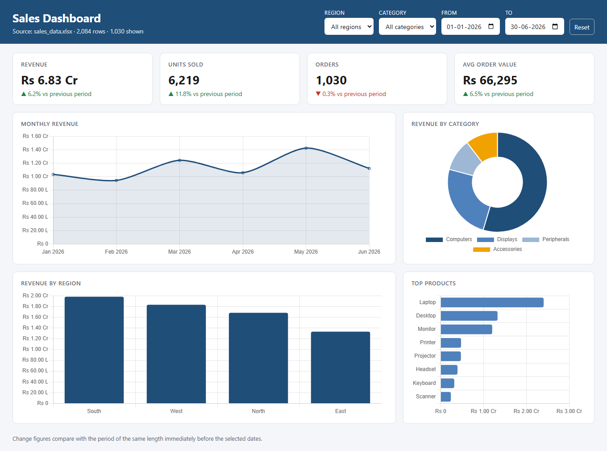
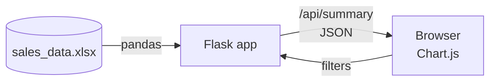

# Sales Dashboard (Flask + Excel)

An interactive web dashboard that reads straight from an Excel workbook. Save the workbook and the dashboard updates: no database, no manual refresh, no rebuilding charts.




---

## The Problem

Many teams keep their sales data in an Excel file. Managers want to see it as a dashboard, so someone rebuilds pivot tables and charts every week and emails screenshots around. Different people end up looking at different versions of the numbers.

## The Solution

A small web app that sits on top of the same Excel file:

1. The team keeps updating the workbook as usual
2. Anyone on the network opens the dashboard in a browser
3. Filters (region, category, date range) recalculate every card and chart instantly
4. When the workbook is saved, the next page load picks up the new data automatically

## Features

| Feature | Details |
|---|---|
| 📊 KPI cards | Revenue, units, orders and average order value |
| 🔁 Period comparison | Each KPI shows the change vs the period of the same length just before the selected dates |
| 🎛️ Filters | Region, category and date range; everything updates without reloading the page |
| 📈 Four charts | Monthly trend, category split, region comparison, top products |
| 📂 Excel as the source | Reads `data/sales_data.xlsx`; re-reads it only when the file changes |
| ✅ Input checks | Clear messages for a missing column or an invalid date range |
| 📱 Responsive | Works on a laptop, tablet or phone |
| 🧪 Tested | 6 automated tests check that the API totals match the workbook |

## How to Use

```bash
pip install -r requirements.txt
```

```bash
python app.py
```

Then open http://127.0.0.1:5000 in a browser.

**Use your own data:** replace `data/sales_data.xlsx` with a workbook whose first sheet has these columns:

| Date | Region | Product | Category | Units | Unit Price | Revenue |
|---|---|---|---|---|---|---|

Or point the app at another file by setting the `SALES_DATA` environment variable to its path.

Run the tests:

```bash
python -m pytest
```

## How It Works



- **`app.py`** loads the workbook with pandas, applies the filters and returns one JSON summary
- **`static/dashboard.js`** calls the API whenever a filter changes and redraws the cards and charts
- The page itself contains no data, so the same API could feed Power BI or another tool

## Project Structure

```
sales-dashboard-flask/
├── app.py                  # Flask app and API
├── templates/
│   └── index.html          # page layout
├── static/
│   ├── dashboard.js        # fetches data and draws the charts
│   └── style.css
├── data/
│   └── sales_data.xlsx     # sample data (2,084 rows, Jul 2025 - Jun 2026)
├── tests/
│   └── test_app.py
├── make_sample_data.py     # recreates the sample workbook (fixed seed)
├── images/                 # screenshot for this README
├── requirements.txt
├── README.md
└── LICENSE
```

## Notes

- The app uses Flask's built-in server, which is fine for a team on an office network. For wider use, run it behind a production server such as Waitress or Gunicorn.
- Chart.js is loaded from a CDN, so the browser needs internet access the first time.

## Roadmap

- [ ] Download the filtered data as Excel
- [ ] Drill-down from a chart to the underlying rows
- [ ] Login for restricted access

---

**Author:** [Swaminathan Narayanan](https://www.linkedin.com/in/swaminathan-narayanan-9781a7154/): Data Analytics | Excel & VBA Automation | Python | SQL | Power BI
